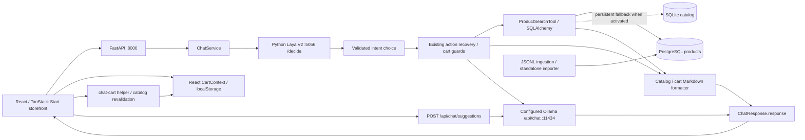

# Architecture

[Main handover](FINAL_PROJECT_HANDOVER.md) · [API](API_REFERENCE.md) · [Operations](DEPLOYMENT_AND_OPERATIONS.md)

Source reviewed on 10 October 2026, HEAD 29d29eb. Diagram edges describe current code, not a proposed redesign. Fresh [health evidence](handover_evidence_2026-10-10/health.json) identifies the current services.

## Components and boundaries



SQLite fallback may initialize and import a local catalog after PostgreSQL connection failure. It is persistent for that process and does not automatically return to PostgreSQL. Laya has no database connection and produces typed decisions, not final product prose. The legacy ONNX service is absent from the active flow: the current client rejects its model identity.

## Representative product-search sequence

```mermaid
sequenceDiagram
  participant U as Shopper
  participant R as React ChatbotPanel
  participant F as FastAPI /api/chat
  participant C as ChatService
  participant L as Laya V2 /decide
  participant T as ProductSearchTool
  participant D as PostgreSQL
  U->>R: Show me the Samsung Tab S7 screen protector
  R->>F: JSON message plus shopai_client_context block
  F->>C: ChatRequest + request database Session
  C->>C: Strip client context from model input
  C->>L: state.message + questions (worker pool)
  L-->>C: answers.intent + genuine confidence/probabilities
  C->>C: Validate; existing discovery guard; extract filters
  C->>T: device terms retained; manufacturer null; bounded search
  T->>D: Parameterized attribute AND text query
  D-->>T: M.A protector, price 999, in_stock false
  T-->>C: Actual catalog row
  C-->>F: Deterministic table, Out of Stock, product marker
  F-->>R: ChatResponse.response
  R->>R: Track recent IDs; render Markdown
  Note over C,R: Search does not add to cart; no Ollama call on this path
```

The previously sampled model chose add_to_cart with confidence 0.2072; the existing discovery guard recovered product_search. The sequence therefore includes guards rather than implying model-only routing. See the [short-accessory investigation](short_accessory_investigation_2026-10-10.md).

## Supported cart flow

An explicit named add is resolved against the database; unknown names do not fall back to stale selection. Out-of-stock rows return a refusal with no mutation command. In-stock rows can emit SHOPAI_ADD_TO_CART. React fetches the actual product again and calls CartContext.addToCart, which rejects inStock=false. Remove/increase/decrease commands include ID, expected quantity and exact one-step resulting quantity. The helper checks current membership, stale state and conflicting markers. These are client cart operations, not orders, inventory reservations or payments.

## Frontend and suggestions

TanStack Start/Vite resolves file routes /, /products and /products/$productId, with root providers in src/routes/__root.tsx. src/router.tsx creates QueryClient per router: staleTime 30 seconds, retention five minutes, no focus refetch. Listing has URL q/category/sort/page, local filter state, and 99 displayed rows plus one sentinel within API limit 100. Details use the product cache. ChatbotPanel is lazy loaded; visible prior turns remain in React but are not sent as full model conversation history.

SuggestionPopup reads the existing product cache without refetching, or listing query/category. Generation starts when context is available. Valid data displays while chat is closed; there is no fixed popup delay timer. Two animation frames measure visibility, not an intentional wait interval. Query/sessionStorage caching is described in [operations](DEPLOYMENT_AND_OPERATIONS.md).

## Concurrency and failures

Chat Laya/Ollama HTTP calls use Starlette's worker pool. Suggestions use a synchronous FastAPI handler. ORM queries remain synchronous inside async product/chat orchestration. Shared requests Sessions and the V2 prediction lock need realistic load testing. V2 HTTP threads queue on a single lock; service latency includes that wait. There is no implemented response streaming, distributed queue or production autoscaling configuration.

Laya failures stop action selection with controlled text; the current adapter has no ONNX fallback. Ollama failures use catalog formatting when supplied products exist, otherwise controlled guidance. Suggestion failures give 503 and hide the popup. Cart context and persisted cart validation remain incomplete.

## Source references

- [Router](../frontend/src/router.tsx), [root providers](../frontend/src/routes/__root.tsx), [API client](../frontend/src/services/api.ts).
- [Chat orchestration](../backend/app/services/chat_service.py), [V2 adapter](../backend/app/services/laya_client.py), [questions](../laya_v2_service/shopai_questions.json).
- [Search](../backend/app/tools/product_search_tool.py), [sessions/fallback](../backend/app/database/session.py), [ingestion](../backend/app/database/ingest.py).
- [Generation](../backend/app/services/ollama_service.py), [popup](../frontend/src/components/storefront/ProductSuggestionPopup.tsx), [cart helper](../frontend/src/lib/chat-cart.ts).
