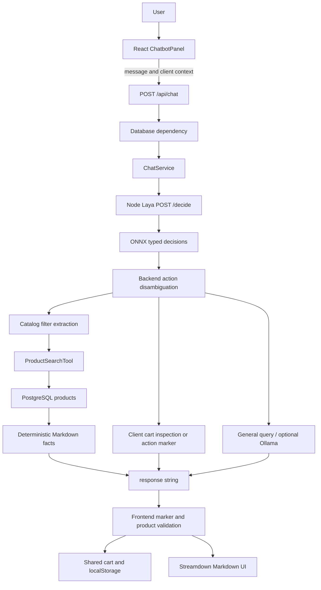

# Poorvika ShopAI technical audit

**7 October 2026 (IST)** · branch `main` · HEAD `fe36d13`.

Application code, configuration, model selection, services and database data were not changed. No push, restart, ingestion, checkout or full benchmark was performed. Only this Markdown report and its [sanitized evidence](shopai_audit_evidence_2026-10-07.json) were created. Findings distinguish current source, live observations and historical artifacts. “NOT VERIFIED” means the inspected evidence does not establish the claim.

## 1. Principal findings

- **Currently reachable Laya is base at port 5055**, reporting `model_mode=base`, `model_id=convaiinnovations/laya`, loaded=true, fallback=false. Backend settings target localhost:5055/decide. Port 5056 was unreachable. The environment of an independently running backend process is NOT VERIFIED. [E]
- Historical base-attributed accuracy is **718/2000 = 35.90%**; isolated specialist ONNX is **1530/2000 = 76.50%**. Raw answers were independently rescored during this audit. Gain: **812 correct, +40.60 percentage points, +113.09% relative accuracy**. This is typed-decisions accuracy, not ShopAI shopping accuracy. [B,S,E]
- **Accuracy improved, but measured request latency increased**: mean 8847.84 → 11641.46 ms, approximately +31.57%. Repository ECE worsened; soft-gold Brier and score MAE improved. Both complete runs had zero failed decisions. [B,S]
- The latest `baseline_v2_20261006_214159` result is **mislabeled specialist evidence**. Every raw response identifies the specialist checkpoint/hash; answers match the isolated specialist run exactly. The runner hardcodes a base summary label. [L,R,E]
- Live PostgreSQL has **508 products**, no duplicate IDs/names, no stock/in-stock inconsistency. Actual retailer stock freshness is NOT VERIFIED. [E]
- Fresh checks passed **41/41 backend routing regressions, 12/12 frontend cart tests, and TypeScript no-emit compilation**. Browser/cart persistence is NOT VERIFIED. [E]
- Source defects include unreachable catalog Next-page navigation and a committed specialist entry point importing implementation from an entirely ignored directory.

### Evidence key

| ID | Exact source |
|---|---|
| E | [Fresh audit evidence](shopai_audit_evidence_2026-10-07.json): live health, read-only database query, fresh tests and independent raw rescoring |
| B | [Historical base summary](../evaluation/jev_benchmark/results/baseline_v2_20261004_summary.json), [raw](../evaluation/jev_benchmark/results/baseline_v2_20261004_raw.jsonl) |
| S | [Specialist ONNX summary](../evaluation/laya_specialist_onnx_isolated/benchmark/runs/20261005_184532_IST/specialist_summary.json), [raw](../evaluation/laya_specialist_onnx_isolated/benchmark/runs/20261005_184532_IST/specialist_raw.jsonl) |
| L | [Mislabeled latest summary](../evaluation/jev_benchmark/results/baseline_v2_20261006_214159_summary.json), [raw](../evaluation/jev_benchmark/results/baseline_v2_20261006_214159_raw.jsonl) |
| R | [v2 runner](../evaluation/jev_benchmark/run_baseline_v2.py), [parser](../evaluation/jev_benchmark/runner.py), [metrics](../evaluation/jev_benchmark/metrics.py) |
| I | [Historical specialist integration summary](../evaluation/laya_specialist_onnx_isolated/integration/live_runs/20261005_205325/final_summary.json), [report](../evaluation/laya_specialist_onnx_isolated/integration/live_runs/20261005_205325/shopai_integration_report.md), [backend log](../evaluation/laya_specialist_onnx_isolated/integration/live_runs/20261005_205325/backend.log) |
| F | [Later regression summary](../evaluation/laya_specialist_onnx_isolated/integration/live_runs/20261005_210712_regression_fixes/validation_summary.json), [report](../evaluation/laya_specialist_onnx_isolated/integration/live_runs/20261005_210712_regression_fixes/validation_report.md) |
| A | [Historical 58-query application metrics](../evaluation/results/summary_metrics.json), [instrumentation](../evaluation/benchmark_runner.py), [heuristic scorer](../evaluation/metrics.py) |
| N | Installed package source: `laya_service/node_modules/@receptron/laya/dist/laya.js`, `sequence.js`, `download.js` |

## 2. Repository and technology

Implementation directories: frontend/, backend/, laya_service/, evaluation/, data/, scripts/. Also present: benchmark_results/, ignored ecom-muse-main-backup/, local dependency/cache trees. Backups are not treated as current implementation. `jev_benchmark` denotes the LocalLLaMA typed-decisions evaluation, not a demonstrated separate production JEV service.

| Layer | Verified technology |
|---|---|
| Frontend | React declared ^19.2.0; TypeScript ^5.8.3; Vite 8.1.5; TanStack Start/Router/React Query; Tailwind CSS 4; Radix UI, Lucide, Sonner; Streamdown Markdown |
| Build/server | Lovable Vite/TanStack configuration, Nitro build integration and Cloudflare target configuration. Actual Cloudflare deployment NOT VERIFIED |
| Backend | Python 3.13.3; FastAPI/Uvicorn; Pydantic v2/Settings; SQLAlchemy; psycopg3; requests/httpx |
| Database | Live PostgreSQL 18.6, `shopai`, localhost:5432; persistent SQLite fallback also implemented |
| Laya | Node v22.14.0, installed @receptron/laya 0.1.2 and onnxruntime-node 1.30.0, CPU ONNX |
| Generation | Configured local Ollama llama3.2:latest, localhost:11434/api/chat |
| Acquisition/evaluation | Python requests/BeautifulSoup catalog scripts; separate Ragas, ShopAI pipeline, typed-decisions and checkpoint/ONNX validation |

Frontend versions above are declarations, not a complete installed-lock audit. Installed local Python distributions: FastAPI 0.142.2, Uvicorn 0.54.0, Pydantic 2.13.5, Pydantic Settings 2.15.0, SQLAlchemy 2.1.2, psycopg 3.3.6, requests 2.34.2, httpx 0.28.1. Existing process-loaded versions are NOT VERIFIED. Backend requirements use lower bounds rather than a locked environment. Sources: package/requirements files, installed distribution metadata, .venv/pyvenv.cfg.

## 3. Architecture and complete user-message flow

FastAPI resolves its database dependency before the route body, even for general chat. Nonempty messages make one Laya call, followed by business rules that may override its choice. Search, details, recommendations, cart operations and simple acknowledgments currently use deterministic responses. Remaining general queries may invoke Ollama. A database query is not always followed by generation. Sources: chat route, ChatService, LayaClient, ProductSearchTool, OllamaService.

**Exact contract:** POST /api/chat with `{"message":"..."}` → `{"response":"..."}`. Pydantic requires a string message; there is no explicit length bound, conversation ID or typed cart field. Blank text returns an instruction to provide a message; invalid/missing field types undergo FastAPI validation.

Frontend appends `\n\n<shopai_client_context>JSON</shopai_client_context>` with recent_product_ids and cart entries containing id/name/price/quantity. Backend strips/decodes this suffix; malformed JSON becomes empty context. Laya receives only the cleaned current message, not history/cart. Recent IDs support backend reference resolution. This is stateless client-context transport, not a server conversation store.

Database unavailability may return 503. Laya failure is caught and produces HTTP200 with an explanatory response string; backend does not recover an intent on that failure. Ollama errors yield fallback text. Unchecked nested cart values can raise errors. Route timing excludes dependency resolution before entering the route. Sources: schemas/chat.py, routes/chat.py, services/chat_service.py.

## 4. Frontend analysis

| Responsibility | Exact source / behavior |
|---|---|
| Root providers/layout | src/routes/__root.tsx: QueryClientProvider, CartProvider, Navbar, outlet, footer, chatbot, CartDrawer, toaster/error boundaries |
| Routing/cache | src/router.ts, generated file routes; stale time 30 seconds, garbage collection 5 minutes, no focus refetch |
| Chat entry | components/storefront/Chatbot.tsx: floating button, lazy panel retained after first opening |
| Chat UI | ChatbotPanel.tsx: welcome “Hi! What are you looking for today?”, chips, in-memory messages, busy shimmer, duplicate-submit guard and error reply |
| API | src/services/api.ts: fetch, VITE_API_BASE_URL, HTTP errors, product normalization and catalog/search/detail/chat calls |
| Markdown | components/ai-elements/message.tsx: Streamdown with CJK/code/math/Mermaid plugins; API returns complete nonstreaming text |
| Response cleanup | src/lib/shopping-response.ts: whitespace/break cleanup and diagnostic-word suppression |
| Listing | routes/products.index.tsx, ProductGrid.tsx, ProductFilters.tsx: React Query, URL q/category/sort/page, local filters, skeleton/error/empty states |
| Details/cards | routes/products.$productId.tsx, ProductDetails.tsx, ProductCard.tsx: catalog facts/images/specs, detail links, stock/add buttons |
| Navigation/footer | Navbar.tsx, CategoryNav.tsx, SearchBar.tsx, SiteFooter.tsx |
| Cart | context/CartContext.tsx, CartDrawer.tsx, lib/chat-cart.ts |

Cart storage key is `shopai_cart_items`; totals derive from stored product price × quantity. State writes on changes and listens for cross-tab storage events. Stored rows are not fully schema/range validated. Out-of-stock check is inStock===false; missing flags pass. Quantities are not capped by inventory. Chat/recent IDs do not survive reload.

**Chat additions are independently checked by the frontend:** SHOPAI_ADD_TO_CART marker → GET product by ID → shared addToCart stock check. Lookup/out-of-stock failure replaces false server confirmation. Remove/increase/decrease markers require a valid action, string ID, safe-integer quantities, current item, matching expected quantity and allowed one-step result. Frontend generates mutation confirmation, rejects stale state/conflicting markers. Increase uses cached stock rather than a fresh lookup. Atomic concurrent-update behavior is NOT VERIFIED.

SHOPAI_PRODUCTS records recent IDs and is removed from visible text. Explicit names beat stale selection; unnamed references use the first resolvable recent ID, potentially ambiguous when multiple results exist. Merely opening a product page does not establish a verified selected-product channel to chat. Twelve helper tests pass, but do not mount React or validate browser persistence.

## 5. Backend and Laya integration

Verified routes: GET /, /api/health, /api/products, /api/products/search, /api/products/{product_id}, /api/categories, /api/brands; POST /api/chat and **/api/products/ingest**. Product lists accept category/brand, price, stock/rating/discount filters, sort, limit 1–100 and offset; search adds q. Ingest upserts data and was not called here. No demonstrated order/payment/authenticated cart API exists in this path.

Actual ShopAI actions: **product_search, product_details, recommendation, add_to_cart, cart_action, general_query**. Default service questions include this choice and a noul human-escalation question. Backend sends `{"state":{"message":"cleaned message"}}`; the service supplies questions.

**Laya decides typed outputs; it does not access PostgreSQL, search products, mutate browser cart or generate prose.** Runtime returns model/answers/usage. Choice includes choice/probabilities/confidence/rl_agent.act_probability; score includes expected ordinal score, probabilities/legend; noul is P(true). Softmax uses type/cardinality temperatures, choice uses argmax; questions are batched in one forward pass. output_tokens=0. [N]

LayaClient validates ONNX source, rejects laya-fallback-router, and checks choice type/membership. It returns choice/probabilities/confidence/noul/source. Persistent requests.Session, timeout 60 seconds, no application retry loop.

### Confidence, escalation and routing

LOW_CONFIDENCE=0.15 is **unused**. Confidence/noul are logged but do not trigger clarification, abstention or escalation. act_probability is ignored. Choice/score confidence is `1 - entropy(p)/log(K)`, not maximum probability or probability of correctness. [N], LayaClient, ChatService.

After Laya succeeds, rules override acknowledgments/details/cart view/explicit mutations, block unintended add decisions, and recover search from discovery/catalog terms. This is hybrid orchestration: final action accuracy is not raw Laya accuracy. Filter extraction calls LLMService's rule parser, then refines categories, budgets and model terms. Its older cloud intent/generation methods are not the active catalog route.

ProductSearchTool combines meaningful terms across name/brand/category/model/description; category synonyms, brand/price/stock constraints; default name-position then stock/rating/price ranking. Recommendations require stock and rank rating/reviews, explicitly disclaiming verified gaming/photography performance. PostgreSQL strpos and SQLite instr are selected by dialect.

Ollama uses persistent Session, 120-second timeout, stream=false, temperature 0.1, num_predict 72, num_ctx 2048 and keep_alive 10m. Compact catalog prompt and graph/HTTP reuse already exist. Current general queries pass product-free business context to a catalog-only prompt: policy/support correctness is NOT VERIFIED. No active verified policy corpus was found.

## 6. Current model versus historical configurations

| Context | Verified identity/configuration |
|---|---|
| Current backend settings | localhost:5055/decide, local llama3.2:latest; TESTING_MODE=false [E] |
| Reachable Laya 5055 | base, ONNX hash reported a874eb254b58b0fcb1e7ad56fbb188c29d64e08c9a46b689433e1f52c66dba1e; revision/source weights null; 512/192 context; loaded=true [E] |
| Legacy npm start | node server.js; Laya.load() downloads package default receptron/laya-onnx; default 5055; health text names convaiinnovations/laya [N] |
| Node switchable entry | default 5056; LAYA_MODEL=base or specialist; default base; imports ignored integration/service.mjs |
| Older Phase5 adapter | LAYA_MODEL=base or typed-decisions; isolated Python laya 0.3.26; separate selector |
| Historical ONNX specialist | pinned specialist, FP32 CPU, ephemeral endpoint port61410 [S] |
| October6 baseline-named run | all raw identities specialist; mean13665.53/P50 13317.98/P95 23341.80/max32856.63 ms [L] |

Live health shape matches switchable implementation; exact running command line remains NOT VERIFIED. Live loaded bytes were not independently rehashed. Historical base raw records lack model_id/revision/hash: their base attribution relies on saved configuration, with weaker provenance than specialist.

Specialist manifest: model `convaiinnovations/laya-typed-decisions`; revision `1a793eb568e6718f15941d08f85432581df534e3`; weights SHA256 `4fa56de72383a9d3efa9cfa78955733c81b9fc8067a587ca4beb82c78107a24e`; ONNX SHA256 `e2b4eeeb1347a94680839a0bdcd473de53c151ab6134193c82ba525459c59474`. FP32 export opset18, recorded 421293827 parameters, ONNX1686148685 bytes, max_len1024/head_max_len256. Encoder ModernBERT-large/two head layers/fine-tuning metadata. A new architecture versus base is **NOT VERIFIED**: demonstrated change is checkpoint/config/export while Node runtime stays0.1.2. Sources: manifest.json, bundle/laya_config.json, validation_report.md.

Legacy server falls back heuristically on load/inference errors; backend rejects its fallback model marker. Switchable instead stops on hash/config/load error and returns inference HTTP500, fallback=false. Legacy health HTTP200/status ok does not guarantee loaded model. Current live health reports base and fallback=false; historical specialist integration is not proof of current specialist production deployment.

## 7. Benchmark Results — final comparison table

Primary pair: original complete baseline [B] versus isolated Node specialist [S]. Dataset LocalLLaMA/typed-decisions/test:400 cases, five questions each,2000 decisions; choice600/score800/noul600; four workflows100 cases/500 decisions each. Current dataset hashes, inputs/questions/gold were verified against all raw records in three runs. [E]

| Area | Old/Base [B] | New/Specialist ONNX [S] | Impact / direction |
|---|---:|---:|---|
| Model ID | convaiinnovations/laya, saved attribution | convaiinnovations/laya-typed-decisions, raw verified | Checkpoint change |
| Runtime | @receptron/laya 0.1.2 ONNX | @receptron/laya 0.1.2 FP32 ONNX CPU | Same Node runtime |
| Checkpoint revision | NOT VERIFIED | 1a793eb568e6718f15941d08f85432581df534e3 | Specialist pinned |
| Context | Current base512/192; original bytes NOT VERIFIED | 1024/256 | Larger limits |
| Overall accuracy | 718/2000=35.90% | 1530/2000=76.50% | +40.60pp; higher better |
| Choice accuracy | 173/600=28.8333% | 439/600=73.1667% | +44.3333pp,+266 correct; higher better |
| Score accuracy | 254/800=31.75% | 578/800=72.25% | +40.50pp,+324 correct; higher better |
| Noul accuracy | 291/600=48.50% | 513/600=85.50% | +37.00pp,+222 correct; higher better |
| Score MAE | 0.69050688 | 0.2470581375 | -0.4434487425; lower better |
| Brier soft gold | 0.1004052172 | 0.0188593649 | -0.0815458523; lower better |
| ECE repository definition | 0.1534187000 | 0.4175605000 | +0.2641418000; lower better, worsened |
| Mean latency | 8847.84ms | 11641.46ms | +2793.62ms; lower better |
| P50 | 9590.26ms | 12517.73ms | +2927.47ms; lower better |
| P95 | 14133.02ms | 18004.62ms | +3871.60ms; lower better |
| Maximum | 16615.78ms | 34827.02ms | +18211.24ms; observed workload |
| Timeout | 60seconds | 60seconds | Same policy |
| Requests | 400 sequential,0retries | 400 sequential,0retries | Five questions/request |
| Successful/failed decisions | 2000/0 | 2000/0 | Complete pair |
| Failed requests | 0 | 0 | No reliability gain established |
| Fallback | 0classified responses | 0identity-checked responses | Complete ONNX pair |
| Reliability | 400complete requests | 400complete requests | Production reliability NOT VERIFIED |
| ShopAI impact | Historical routing errors | Better generic typed decisions; shopping errors remain | Paired current shopping improvement NOT VERIFIED |

Absolute gain812 correct; relative accuracy improvement `(76.50-35.90)/35.90` =113.09%, or2.131× original accuracy. Percentage points are not relative percentages. Accuracy improved but request latency increased approximately31.57%. Different run times and uncontrolled host load prevent isolating checkpoint-only latency causality.

| Workflow | Base correct/500 | Specialist correct/500 | Accuracy change |
|---|---:|---:|---|
| agent_trace_observability |193|365|38.6%→73.0%|
| customer_service |191|382|38.2%→76.4%|
| invoice_processing |176|400|35.2%→80.0%|
| security_incidents |158|383|31.6%→76.6%|

Sources [B,S]. Historical Python results are separate: Phase4 direct and Phase5 HTTP specialist report1532/2000=76.60%, choice440/noul514/score578; Node has439/513/578. Phase4 Python mean7973.81ms; Phase5 Python HTTP9696.47ms. Do not substitute these for Node timings. PHASE5_OPTIMIZATION_REPORT describes choice11+ temperature clamping; Node preserves exported configuration. Exact cause of two-label difference NOT VERIFIED. Specialist training on official train split is recorded in reports; independent training/test overlap investigation was not performed. This is not zero-shot generalization evidence.

Sources: phase4_typed_decisions_candidate_20261004_full_summary.json, phase5_optimized_typed_decisions_20261004_summary.json, PHASE5_OPTIMIZATION_REPORT.md in evaluation/jev_benchmark/results/.

## 8. Benchmark Validity / Reliability

Primary pair shares dataset/gold/parser/scorer, sequential requests and60-second timeout/no retries. Specialist runner imports baseline implementation, changes endpoint/output naming, and enforces specialist ID/revision/hash/source/fallback. Checks preserve input/gold/order and protected hashes. Audit independently reparsed raw answers and reproduced accuracy/Brier/ECE. [R,S,E]

Original laya_jev_benchmark_summary.json instead has **1385 successful/615 failed decisions** out of2000. Its35.23% accuracy excludes failures: choice404,score554,noul427 successful. It is not the complete35.90% baseline. Exact transport-error/connection-reset categories were not independently reconstructed from its full raw error set; detailed retry/reset attribution is NOT VERIFIED.

Original compute_all_benchmark_metrics accuracy uses successful decisions; v2 strict accuracy=correct/expected, successful-only=correct/successful. Failed case remains five expected rows in v2. MAE/calibration use eligible successful rows. Strict/successful-only agree in primary pair because all succeeded.

Scoring: choice selected label versus gold; score label uses argmax while MAE compares expected numeric score; noul P(true)>=0.5. Brier uses soft gold, 1/K-normalized squared distribution error over unioned outcomes. ECE uses10bins: entropy confidence for choice/score, max binary probability for noul. Thus lower reported ECE is preferred by repository metric, but this mixed confidence metric is not a universal calibration assessment. Typed-decisions percentile interpolation is linear. [R,N]

Original “decision latency”=case latency/5 is amortized, not independently timed. Use measured case latency.

**Mislabeled latest run:** v2 summary hardcodes convaiinnovations/laya; source classification accepts generic model=laya/ONNX without base hash enforcement. All October6 raw responses identify specialist/pinned revision/hash. Its13665.53ms mean is another specialist measurement. [L,E]

Complete base repeats reproduce718 correct, with means8427.18,8353.13,8565.55ms respectively in baseline_v2_20261004_rerun,20261005_125336,20261005_212216 summaries. Latency varies; no host-controlled paired inference experiment was performed.

## 9. Latency and bottlenecks

Five-question benchmark requests, two-question shopping decisions, route time and browser end-to-end latency are different.

| Historical specialist application workload [I] | n | Mean | P50 | P95 | Max |
|---|---:|---:|---:|---:|---:|
| Warm direct2-question requests |20|2178.78ms|2105.67ms|2786.79ms|2786.79ms|
| FastAPI API flows |13|2329.39ms|1874.54ms|6098.17ms|6098.17ms|

Historical startup13577.29ms including~4160ms hashes/~8854ms load; first inference1968.07ms. OS cache not flushed. RSS snapshots1598402560→1624211456bytes are not peak; no paired base resource measurement establishes regression. Warm recording used approximately two cores. [I]

Historical iPhone search: Laya5944.5ms, filter extraction4.7ms, retrieval48.8ms with SQL44.0ms nested within retrieval, route6002.4ms. Samsung: Laya3439.6, extraction0.1,retrieval8.9,SQL7.9,total3449.5ms. Laya decision HTTP time dominates. [I/backend.log]

A separate older recommendation used Ollama: total15251.1ms, Laya1960.1,retrieval4.3/SQL4.0,Ollama13285.7ms, model load9810.035,generation447.457ms. That demonstrates an Ollama cold-load bottleneck in the older path. Current recommendations skip Ollama; this is not current recommendation latency. [I/backend.log], current ChatService.

Historical58-query artifact [A]: total mean1869.63/P501345.96/P952814.63/max15573.68ms; Laya mean1460.72ms(n58), retrieval8.21(n33), Ollama2119.22(n11). Runner calls ChatService directly: these are **in-process measurements**, not browser/API transport latency. “Postgres” intercept includes retrieval/serialization; baseline_comparison has zero samples. Nominal asyncio45-second timeout cannot reliably interrupt synchronous HTTP inside async code.

Inference/tokenization/network breakdown, dependency time, frontend rendering, request queueing and concurrent P95 are NOT VERIFIED. No new inference benchmark was launched. Evidence establishes decision HTTP dominance for measured catalog flows, not that network or ONNX alone caused regression.

## 10. Functional impact and regression status

| Behavior | Current implementation/evidence | Limits |
|---|---|---|
| Search | Controlled SQL, budget/category/model filters, deterministic Markdown and empty results | Mocked routing/search pass; paired current model accuracy unverified |
| “Tell about it”/details | Details override prevents add; explicit name wins stale selection; recent IDs resolve references | Passing test; ambiguous multi-result “it” can select first ID |
| Recommendation | Stock/rating/budget candidates and disclaimer for gaming/photography | Not verified performance comparison |
| Add it to cart | Backend real product/stock guard; frontend fetch and stock check | Helpers/backend pass; browser sync unverified |
| Cart view/total | Uses supplied cart; empty context does not invent contents | Client price/name/quantity are not payment authority |
| Remove/increase/decrease | Backend marker and frontend validation present | Fresh tests pass; old “unsupported removal” reports historical |
| Thank you/thanks/okay | Backend acknowledgment overrides and deterministic replies | Raw specialist mistakes persist in historical record |
| Mobile category | Mobiles navigation/normalization/synonyms; live91Mobiles | Controlled mobile search passes |
| General/policy | Optional Ollama without verified policy corpus | Accurate support answer unverified |
| Low confidence | No active threshold/noul escalation | Clarification policy missing |

Historical raw specialist “Thank you” chose add_to_cart, confidence0.0038; Thanks chose product_search; Okay chose cart_action. Backend corrected final actions. This disproves a claim that specialist itself fixed all shopping bugs. [I]

Earlier backend suite5/8 failures were stale count/stock assertions and SQLite strpos. Later8/8 report fixes are present today. [F] Current removal implementation supersedes older unsupported-removal text; fresh checks establish controlled behavior, not newer live-browser acceptance.

[A] raw shopping intent39/58=67.24%, macroF1 0.5126; factual heuristic evaluated37:20correct,1partial,13incorrect,3unsupported. Search-only instrumentation and number/token matching limit this scorer; not a full factual review.58/58 “successful” execution does not mean correct answers.

Current Ragas summary.json covers **one generated response** among12cases,11deterministic. Faithfulness1.0,relevancy0.751014,precision~1.0,recall1.0 cover only that row. README describes an older5-response result. Neither establishes current overall accuracy. Ragas/cloud judge is offline, not the request pipeline.

## 11. Database analysis

Read-only direct PostgreSQL transaction: shopai/localhost5432/PostgreSQL18.6,508rows,0duplicate IDs,0duplicate-name groups,0 stock-flag inconsistencies. Canonical JSONL508unique IDs/names, SHA256 `7d789404c6d93ce0b21550b36e62d1fd875f99a66ff9817f2345e473c0e71148`. [E]

SQLAlchemy products model: string primary ID(source product_id); name,brand,model,category,unique nullable SKU/item codes; Float price/online_price/MRP/shop_price/discount; INR currency; integer stock/boolean in_stock/availability; rating/count; images/description/URLs; JSON specifications/flattened_specs/source_hash/scraped_at. Actual type is **JSON**, despite importer comments saying JSONB. Monetary values use Float, not decimal. Ingestion extracts Generic Name/category, derives stock flag, calculates discount, and upserts. Laya never replaces PostgreSQL.

Live categories [E]:

| Category | Count | Category | Count |
|---|---:|---|---:|
|Mobiles|91|Television|56|
|Computers|49|Smartwatches|36|
|Headphones|35|Tablet|26|
|Data Cables|23|Cases & Covers|18|
|Mixers Grinders & Juicers|15|Battery Chargers|15|
|Irons|14|Power Banks|13|
|Refrigerators|11|Temper glass|11|
|Washing Machine|11|Speakers|11|
|Voltage Stabilizers|10|Keyboards|8|
|Chimney|8|Electronics|7|
|Air Coolers|5|Fans|5|
|Voltage Stabilizer|4|Memory Cards|4|
|Air Fryers|4|Smart Keyboard|3|
|Car Chargers|3|Pendrives|2|
|Mother Board|2|AirTag|1|
|Water Purifiers|1|Mouse|1|
|Refrigerator|1|Keyboard|1|
|Surge Protector|1|Food Processor|1|
|Console|1|—|—|

Plural/singular categories remain separate. “TV & Audio” UI sends Audio, mapping only Headphones/Speakers, omitting Television even though tool tv & audio mapping includes it.

Database session automatically creates/ingests persistent SQLite fallback after PostgreSQL failure; once activated it does not automatically return to PostgreSQL. This contradicts settings comments implying only testing uses SQLite. Existing fallback SQLite file is tracked. Audit direct queries bypassed this potentially writing fallback path.

DATASET_PATH=`../data/poorvika_products.jsonl` works from backend startup directory but not root launch. Explicit root launch must resolve path; fallback path is likewise working-directory-sensitive. External stock/price/spec freshness is NOT VERIFIED. Sources: config.py, database/session.py, ingest.py, models/product.py, tool and navigation source.

## 12. Known issues

1. **Pagination:** PAGE_SIZE100, requested min(101,100)=100, hasNextPage requires >100 rows: Next cannot enable. All-products page1 hides normal navigation to remaining408rows; manually specifying page in URL remains possible. Source products.index.tsx and route cap.
2. **Specialist fresh-clone gap:** tracked switchable_server imports integration/service.mjs in wholly ignored evaluation/laya_specialist_onnx_isolated/. Manifest/bundle also ignored. Advertised command requires separately provisioned assets/code.
3. **Blocking concurrency risk:** async routes call synchronous requests/SQLAlchemy; event-loop blocking follows from source, impact unmeasured.
4. **Uncertainty policy missing:** unused confidence threshold/noul/act; recovery rules, not demonstrated raw model correctness.
5. **Checkout simulation:** CartDrawer waits1.2seconds, shows successful order and clears cart without order/payment API. Fulfillment NOT VERIFIED.
6. **Client truth/input gaps:** stale prices/stock, no inventory cap/reservation, unchecked nested context/storage quantities, no explicit message/body limits. Quantity validation is stronger for mutation commands than stored state.
7. **Presentation:** broad word suppression including API/database can hide legitimate specs; catalog names/specs not escaped for Markdown table separators.
8. **Static claims:** hero “iPhone18PRO / AVAILABLE NOW” links to Accessories; delivery/warranty promises are static, not catalog-backed. Their external validity was not researched or asserted.
9. **Documentation/provenance drift:** latest baseline mislabeled; Ragas README stale; old unsupported-removal text superseded by code/tests. Production/default model must be stated separately from specialist experiments.

## 13. Security / Configuration Audit

No secret values are included in this report/evidence.

| Check | Status | Evidence/limit |
|---|---|---|
| Local database password field | FOUND | Nonempty backend/.env setting; value withheld |
| Default hardcoded DB credential | FOUND | config.py default requires development/deployment review |
| Backend .env Ollama/API key field | NOT FOUND | Inspected local keys; process-injected keys NOT VERIFIED |
| Tracked .env at HEAD | NOT FOUND | git ls-files; environments ignored |
| .env in all-ref filename log | NOT FOUND | Content-wide historical scan NOT VERIFIED |
| Confirmed real token/private key in tracked source | NOT FOUND by bounded heuristic | Some product/evaluation token-like strings remain NEEDS REVIEW; not exhaustive |
| Logs/artifacts secret hygiene | NEEDS REVIEW | Dedicated scanning/redaction of raw JSON/logs required |
| Example env provisioning | NEEDS REVIEW | .env.* ignores .env.example; local examples untracked |
| POST /api/products/ingest protection | NEEDS REVIEW | No demonstrated authentication dependency |
| Input/rate limits/service auth | NEEDS REVIEW | No established auth/rate/body limits in active service routes |
| Cart financial authority | NEEDS REVIEW | Client totals; no server order/stock authority |

.gitignore excludes environments/dependencies/caches/models/results, but also required specialist source and examples. Legacy Node server has wildcard CORS and no explicit loopback bind; switchable binds127.0.0.1; backend defaults loopback/local CORS. CORS is not authorization. Internet exposure, firewall/TLS, retention and access controls are NOT VERIFIED. Logs include user messages/filters/decisions. Scan emitted filename/line/status only. Absence of confirmed keys does not establish no secrets in history, binaries, caches/untracked outputs or process environment.

## 14. Testing

| Evidence | Result | Scope |
|---|---|---|
| Fresh frontend Node tests |12/12PASS|Cart helper/mock actions; not React/browser|
| Fresh backend routing tests |41/41PASS|Canonical catalog in SQLite memory, controlled Laya/Ollama mocks|
| Fresh TypeScript |exit0|tsc --noEmit; no build files|
| Main backend suite |8tests, historical8/8[F]|Some live inference/legacy extraction/API dependencies; not rerun here|
| Python specialist parity |historical8fixturesPASS|Reference/ONNX numerical/shape checks|
| Node specialist parity |historical8fixturesPASS|Token/marker/typed-output compatibility|
| Specialist API acceptance |historical12/13[I]|Real catalog/API, simulated cart; removal then failed|
| Smoke/failure injection |historicalPASS[F]|Loading/HTTP500/no fallback/CORS, not freshly rerun|
| Historical build log |Nitro completion|Warnings: >500kB chunks, WASM fallback; exact exit/HEAD binding NOT VERIFIED|
| Current production build/browser acceptance |NOT VERIFIED|No rebuild/browser automation performed|

Backend classes total49cases(41routing+8main), frontend helper12. Fresh backend runner replaced only setup/teardown in process with SQLite memory to avoid temporary-file deletion; test source/assertions/mocks unchanged. Existing diagnostic evaluation/test_*.py print outputs and are not assertion-based CI suites. Benchmark runs are separate. No current-HEAD CI/frontend component/E2E coverage verified. Helper success is not localStorage reload/multitab UI evidence.

## 15. Git / GitHub readiness

Initial status: main, no modified tracked files; untracked dataset/, phase4_experiment/, phase5_model_config.json, reference_validation.py under evaluation/jev_benchmark/.197tracked files. Recent commits: fe36d13 ignored benchmarks;6b731f7 specialist/ShopAI improvements;a874932 scraper/sitemap;75052ad chatbot/Laya/benchmark;291a625initial. Remote synchronization/CI/PR state NOT VERIFIED; nothing pushed.

Tracked >1MB: data/poorvika_products.jsonl and poorvika_products_expanded.jsonl each3478197bytes; sitemap1491197bytes. Specialist ONNX~1.686GB should stay external. Tracked fallback SQLite needs generated-data policy. Central benchmarks/results are ignored, so Git alone cannot reproduce claims. Review experiment code/dataset provenance before staging; avoid git add . over research trees.

Recommended commits only (no commits/code changes made):

1. `docs: add source-backed ShopAI architecture and Laya audit` — these documentation artifacts.
2. `fix: make specialist Laya integration reproducible` — track service source/manifest outside ignored binary paths; pinned bundle provisioning; sanitized env examples/selectors.
3. `fix: correct catalog pagination and category navigation` — Next predicate and TV mapping, targeted tests.
4. `fix: enforce Laya identity in benchmark summaries` — ID/revision/hash assertions; additive correction manifest preserving frozen raw data.
5. `fix: validate chat cart context and restrict catalog ingestion` — schema/ranges/authorization and tests.
6. `perf: isolate blocking inference and measure ShopAI concurrency` — after measured controlled before/after evidence.

6b731f7 already contains implementation; do not recommit it or infer ignored specialist files are tracked from its title. Frontend AGENTS.md forbids rewriting published Lovable-connected history: no force-push/rebase/amend of published commits.

## 16. Benefits and trade-offs

Verified specialist gains: +812typed decisions, +40.60pp overall; choice+266,score+324,noul+222; lower score MAE and soft-gold Brier; same Node contract/runtime; historical parity and hash-checked identity. [B,S]

Costs/limits: higher measured mean/P50/P95; worse repository ECE; raw acknowledgment errors remain; extra bundle/provisioning dependencies and context config complexity. Historical startup/RSS are measured, but base-paired resource/loading regressions are NOT VERIFIED. Python/Node selector/temperature differences require explicit compatibility handling. Zero-failure complete base versus zero-failure specialist establishes no reliability gain. Generic typed-decisions gains do not quantify current shopping routing, business outcome or deployed end-to-end performance.

## 17. Recommendations

### A. MUST FIX

- Enforce model provenance and add a correction for October6 mislabeled specialist run; preserve frozen raw/gold/results.
- Make fresh-clone specialist loading reproducible without committing binaries; track necessary code/manifest, pin/provision assets, archive evidence externally.
- Repair pagination/TV-category defects with targeted verification.
- Validate cart context/storage numeric/shape bounds and request sizes; restrict ingest. Real checkout must validate authoritative price/stock/create order before claiming success.
- Complete browser add/remove/quantity/reload/multitab/stale-state acceptance. Maintain separation between model, effective routing and helper tests.
- Define/evaluate uncertainty/clarification/escalation; entropy confidence is not correctness probability.

### B. SHOULD IMPROVE — preserve specialist accuracy while reducing latency

- Retain specialist as evaluated candidate; promotion requires paired current shopping validation, not generic accuracy alone.
- Move blocking HTTP/ORM work off async event loop or use async clients appropriately; measure queueing/concurrency.
- Keep persistent loaded ONNX process. Warm representative requests before declaring ready; startup currently loads but does not guarantee completed warm inference. Report cold/warm separately.
- Existing Sessions/Ollama keep_alive already provide reuse; do not market enabling them as a new change.
- Profile tokenization/actual lengths/padding/session.run/queue time. Test host-appropriate threads. Existing CPU2intra/1inter and graphOptimizationLevel=all are already configured.
- Experiment with omitting unused escalation question when safe: backend ignores it, but require shopping-choice parity and separate evidence; don't alter frozen five-question benchmark.
- Consider exact nonmutating greeting fast path before Laya only as an explicit architecture-policy change, with safety tests. Specialist handles unresolved messages.
- Decision cache keys must include cleaned message, questions, checkpoint/revision/config and all inputs. Never cache stale catalog facts or full cart responses; retain downstream context/product validation.
- Resolve dataset path against stable root and make fallback state/recovery explicit; retain data bytes.
- Review general-query prompt/policy corpus and static storefront promises.

### C. OPTIONAL OPTIMIZATION

Test providers/export changes/quantization in isolated parity/gold/safety experiments; speed/accuracy benefit NOT VERIFIED. Do not shrink context arbitrarily. Cross-request batching only makes sense under sufficient throughput and can increase interactive waiting; internal question batching already exists. Report P50/P95/failures/identity/concurrency/warm-cold after each change, and keep fast-path/business performance separate from raw benchmark scoring.

## 18. VERIFIED FACTS / INFERENCES / NOT VERIFIED

**A. VERIFIED:** current local base health/configured5055; read-only508catalog and uniqueness/stock consistency; raw718/1530recomputed metrics; latest raw identities specialist; measured latency and ECE increases/Brier-MAE reductions; backend overrides and unused confidence;41+12fresh tests/tsc pass; pagination/provisioning defects and simulated checkout.

**B. INFERENCES:** synchronous work can impair concurrency; measured warm-up/thread/one-question/fast-path experiments may help; generic accuracy may help some shopping routing but magnitude unknown; live health shape suggests switchable implementation, exact command unverified.

**C. NOT VERIFIED:** historical base immutable revision/loaded weights; independently rehashed live bytes; deployed backend environment/production model/traffic/SLOs; current paired shopping accuracy/latency; browser persistence/visual acceptance/current build; retailer facts freshness/fulfillment; ONNX versus network causal timing/concurrent P95; complete history/binary/cache/process secret scan; statistical generalization/training overlap; base-paired memory/load regression.

## 19. Exact inspected-file inventory

Reads include full contents, selected sections, source searches, parsed fields or raw records as identified. Enumeration/secret scans are not represented as exhaustive review. Dependency/cache/backup trees and all logs were not fully audited. Paths grouped on a row share the explicitly stated directory.

| Exact paths | Contribution |
|---|---|
| README.md; .gitignore; frontend/AGENTS.md | Startup, ignored assets/examples and Lovable history constraint |
| frontend/package.json; laya_service/package.json; backend/requirements.txt; scripts/requirements.txt; evaluation/requirements.txt; evaluation/jev_benchmark/phase4_experiment/requirements.txt | Commands/dependency declarations |
| backend/.env; backend/.env.example; frontend/.env; frontend/.env.example | Key presence and allowlisted settings only; credentials withheld |
| .venv/pyvenv.cfg | Python version |
| backend/run.py; backend/app/main.py; backend/app/config.py | Startup/CORS/application settings |
| backend/app/routes/chat.py; backend/app/schemas/chat.py; backend/app/routes/products.py; backend/app/routes/health.py | Contracts/routes/timings/DB-health semantics |
| backend/app/services/chat_service.py; laya_client.py; ollama_service.py (same services directory) | Full chat routing, decisions, generation/fallback/timing |
| backend/app/services/llm_service.py | Rule-parser and selected legacy extraction sections |
| backend/app/tools/product_search_tool.py; backend/app/models/product.py | Catalog search/mappings/ranking/model serialization |
| backend/app/database/session.py; ingest.py (same database directory) | Fallback/session dependency/ingestion |
| backend/scripts/import_products.py | Selected importer normalization sections |
| backend/test_backend.py; backend/test_chat_regressions.py | Main tests/controlled regression assertions and fresh test execution |
| frontend/vite.config.ts; frontend/tsconfig.json; frontend/src/router.ts | Build integration/typing/cache |
| frontend/src/routes/__root.tsx; index.tsx (same routes directory) | Providers and selected homepage sections |
| frontend/src/routes/products.index.tsx; products.$productId.tsx (same routes directory) | Listing/pagination/detail fetching |
| frontend/src/services/api.ts; frontend/src/context/CartContext.tsx | Transport/cart persistence |
| frontend/src/components/storefront/Chatbot.tsx; ChatbotPanel.tsx (same directory) | Entry/UI/context/response handling |
| frontend/src/lib/chat-cart.ts; shopping-response.ts (same lib directory); frontend/tests/chat-cart.test.cjs | Marker validation/formatting/tests |
| frontend/src/components/ai-elements/message.tsx | Markdown renderer/plugins |
| frontend/src/components/storefront/ProductCard.tsx; ProductGrid.tsx; ProductDetails.tsx (same directory) | Card/grid/detail facts/stock/actions |
| frontend/src/components/storefront/CategoryNav.tsx; Navbar.tsx; SiteFooter.tsx; SearchBar.tsx; ProductFilters.tsx; CartDrawer.tsx (same directory) | Navigation, selected filters/cart checkout, footer |
| frontend/src/styles.css; frontend/chat-ui-build.log | Selected styles and historical build tail |
| laya_service/server.js; switchable_server.mjs; SPECIALIST.md (same directory) | Legacy/opt-in selection/fallback/instructions |
| laya_service/node_modules/@receptron/laya/package.json; dist/index.js; dist/laya.js; dist/sequence.js; dist/download.js (same package) | Installed runtime, ONNX decoding/entropy/default bundle |
| laya_service/node_modules/onnxruntime-node/package.json | Installed runtime version |
| evaluation/jev_benchmark/README.md; config.py; runner.py; metrics.py; run_baseline_v2.py (same directory) | Dataset/parser/scoring/denominator/identity |
| evaluation/jev_benchmark/dataset/typed_decisions_test.json; test-00000-of-00001.parquet (same directory) | Full JSON parsed; both hashed, Parquet not independently decoded |
| evaluation/jev_benchmark/results/baseline_v2_20261004_summary.json; baseline_v2_20261004_raw.jsonl | Full base metrics/all raw cases reparsed |
| evaluation/jev_benchmark/results/baseline_v2_20261004_rerun_summary.json; baseline_v2_20261005_125336_summary.json; baseline_v2_20261005_212216_summary.json | Repeatability/count/latency |
| evaluation/jev_benchmark/results/baseline_v2_20261006_214159_summary.json; baseline_v2_20261006_214159_raw.jsonl | All raw identity/input/gold and metrics verification |
| evaluation/jev_benchmark/results/laya_jev_benchmark_summary.json; PHASE3_REFERENCE_VALIDATION_summary.json (same directory) | Failed coverage/historical attribution counts |
| evaluation/jev_benchmark/results/jev_verification_typed_decisions_20261004_summary.json; phase4_typed_decisions_candidate_20261004_pilot_summary.json | Selected inventory/count fields |
| evaluation/jev_benchmark/results/phase4_typed_decisions_candidate_20261004_full_summary.json; phase5_optimized_typed_decisions_20261004_summary.json; PHASE5_OPTIMIZATION_REPORT.md | Python runtime/timing/calibration comparison |
| evaluation/jev_benchmark/phase5_model_config.json; phase4_experiment/config.py; phase4_experiment/run_candidate.py | Selector/config/selected Python runner sections |
| evaluation/laya_specialist_onnx_isolated/manifest.json; bundle/laya_config.json; validation_report.md; python_validation_summary.json; node_validation_summary.json | Export identity/hashes/config/architecture/recorded parity |
| evaluation/laya_specialist_onnx_isolated/benchmark/run_experiment.py; benchmark/specialist_service.mjs | Frozen runner/identity checks/service |
| evaluation/laya_specialist_onnx_isolated/benchmark/runs/20261005_184532_IST/specialist_summary.json; specialist_raw.jsonl; configuration.json; integrity_after.json (same run) | Full metrics/raw/config; selected protected hashes |
| evaluation/laya_specialist_onnx_isolated/integration/service.mjs | Selector/hash checks/HTTP errors/thread configuration |
| evaluation/laya_specialist_onnx_isolated/integration/live_runs/20261005_205325/final_summary.json; shopai_integration_report.md; backend.log (same run) | Historical API/warm/load/resources; timing records |
| evaluation/laya_specialist_onnx_isolated/integration/live_runs/20261005_210712_regression_fixes/validation_summary.json; validation_report.md (same run) | Later 8/8 repair/browser limitations |
| evaluation/README.md; evaluation/evaluate.py | Ragas narrative and selected cloud-scoring/capture sections |
| evaluation/results/summary.json; summary_metrics.json; chat_responses.json; ragas_results.json (same directory) | Saved aggregate evidence and selected sanitized security candidates |
| evaluation/benchmark_runner.py; evaluation/metrics.py | Selected raw-intent/timing/factual-scoring implementations |
| evaluation/test_laya_health.py; test_laya_custom.py; test_case0.py; test_hf_api.py (same directory) | Diagnostic probe distinction; not executed |
| scripts/scrape_poorvika_products.py; scripts/expand_poorvika_catalog.py | Source function/search inspection of acquisition; not executed |
| data/poorvika_products.jsonl | Entire JSONL counts/uniqueness/hash and in-memory tests |
| Other tracked text | Bounded redacted secret scan only, not full content review |
| Git metadata; live Laya /health; read-only PostgreSQL | Branch/status/history/file sizes and current live state |
| documentation/shopai_audit_evidence_2026-10-07.json | Fresh verification artifact |

The supplied attachment `C:/Users/GURU/.codex/attachments/181dc9ed-a2da-43d9-838a-d6f2373cd2d6/Pasted text.txt` supplied requirements. Failed attempt to read nonexistent benchmark/service.mjs was corrected to actual specialist_service.mjs; nonexistent file is not evidence. Independent raw rescoring reproduced saved metrics and checked input/gold equality; historical integrity claims were not asserted as independently rerun full experiments.

## 20. Lead-facing executive summary

Poorvika ShopAI combines React, FastAPI, PostgreSQL, a Laya typed-decision layer and optional local Ollama. Current search/details/recommendations/cart answers use deterministic catalog/client-state logic; backend rules can correct Laya's initial action.

The evaluated change is the specialist checkpoint/configuration and validated FP32 ONNX export using the same @receptron/laya 0.1.2 Node runtime. Frozen LocalLLaMA test accuracy rises from 718/2000 (35.90%) to 1530/2000 (76.50%): **+40.60 percentage points, +812 correct**. Soft-gold Brier and score MAE improve. Mean case latency rises 8.85→11.64seconds; P95 14.13→18.00seconds; repository ECE worsens. Both complete runs have zero failed predictions, so improved reliability is not established.

The currently reachable local service identifies base; specialist remains opt-in. The newer baseline-named result is specialist, confirmed by every raw response. Generic benchmark gains do not establish current shopping accuracy: historical specialist acknowledgments still needed backend correction. Fresh 41 backend routing tests, 12 cart helper tests and TypeScript pass; browser/cart persistence remains unverified.

Next: repair identity reporting and fresh-clone provisioning, fix pagination/category wiring, validate/protect cart/ingestion boundaries, and complete browser acceptance. Preserve specialist while profiling actual warm/cold and concurrent ShopAI requests before selecting latency optimizations. Keep model accuracy, application correctness and deployed end-to-end latency separate.
